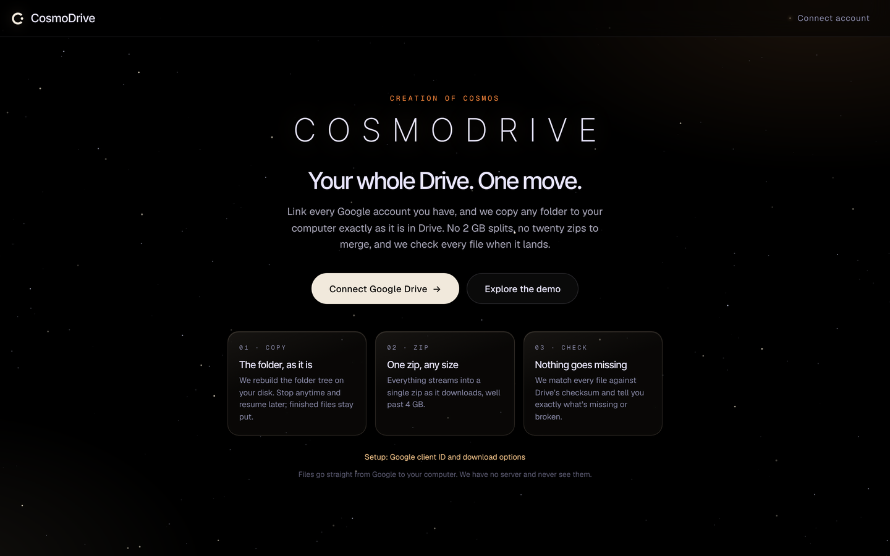
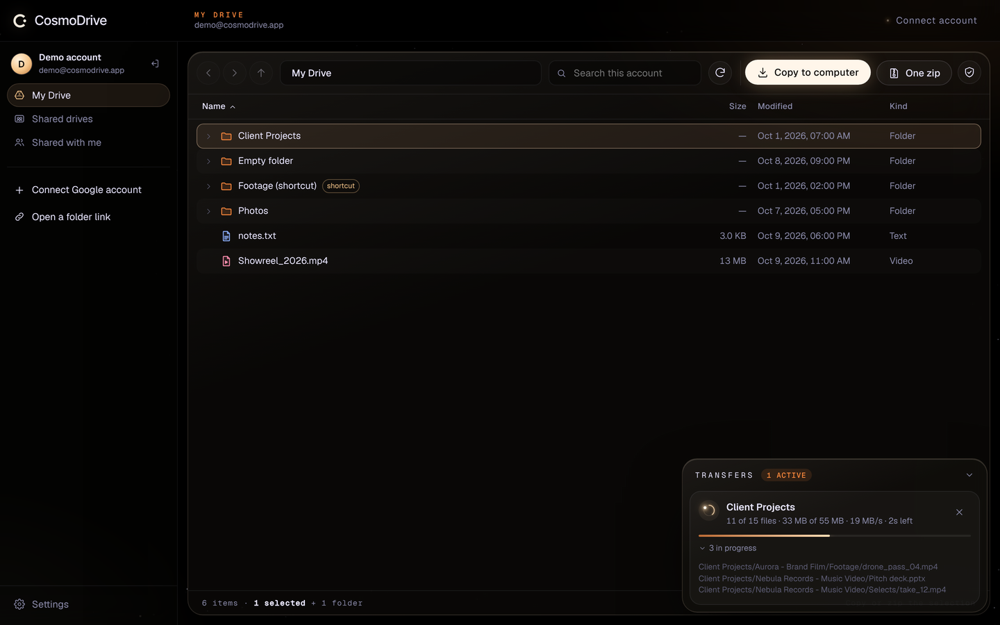
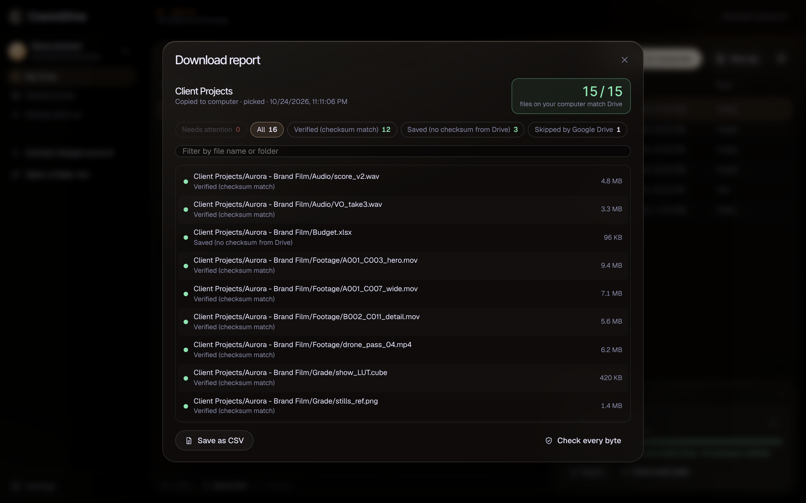

# CosmoDrive

Browse every Google Drive you own and copy whole folders to your computer, exactly as they are in Drive. No 2 GB splits, no stack of `drive-download-…-7.zip` files to merge.

Inspired by [Cyberduck](https://cyberduck.io/), starting with Google Drive only.







## What it does

- **Multiple Google accounts** side by side. Each shows My Drive, Shared drives and Shared with me.
- **Open any folder link.** Paste a `drive.google.com/drive/folders/…` link and it's pinned in the sidebar.
- **Cyberduck-style browser:** expandable folder tree, path bar, back/forward/up, sort by name, size, date or kind, search, multi-select (click, ⌘/Ctrl-click, Shift-click, ⌘A) and keyboard navigation.
- **Copy to computer:** pick a folder on your disk and CosmoDrive recreates the Drive folder tree inside it, downloading 1 to 6 files at a time. If you stop or lose connection, press **Resume**. Files already on disk at full size are kept, so it continues where it stopped.
- **One zip:** streams everything into a single zip file as it downloads. It uses ZIP64, so there's no 2 GB or 4 GB cap, and it never holds the whole thing in memory.
- **Google Docs, Sheets and Slides** are exported to .docx, .xlsx and .pptx, or PDF if you choose that in Settings. Forms and Sites can't be exported by Google, so they're listed as skipped.
- **Every file is checked.** Each download is compared with the MD5 checksum Google Drive keeps for it. A file corrupted on the way is downloaded again automatically, so a broken video can't slip through looking fine.
- **Cross-check report.** When a copy finishes, CosmoDrive compares the folder on your computer with Drive and gives you a verdict like "All 1,204 files are on disk and match Drive". The report lists anything that is missing, different, failed, locked by Google ("retry later"), skipped by Google, or extra on disk. **Fix** downloads only those files again, and **Save as CSV** exports the list for a client or your records.
- **Check a copy** (the shield button): pick any folder already on your computer, even one you unzipped from Drive's own split downloads. CosmoDrive finds what's missing or broken, and **Fix** fills in only the gaps.
- **Resumes inside a file.** If the connection drops 30 GB into a 40 GB file, it reconnects and continues from that byte.
- **Handles Drive's quirks:** duplicate names in one folder (`Invoice.pdf`, `Invoice (2).pdf`), names that are illegal on Windows or macOS, shortcuts (followed, but a folder is never copied twice), rate limits (waits and retries), expired sign-ins (asks you to sign in again, then carries on), Google's 24-hour download lock on popular shared files, files whose owner turned off downloading, Google Docs too large to export, and a full disk (stops cleanly so you can free space and resume). Each problem gets a plain explanation in the report.
- **No server.** Files go straight from Google to your computer. Sign-in tokens are kept only for the current tab.

There's also a **demo drive**, so you can try everything without a Google account. It acts out real problems on purpose: one video arrives corrupted, one connection drops partway, and one shared file is locked by Google.

## Browser support

Copy to computer and streaming zips need the File System Access API: **Chrome, Edge, Brave, Arc or Opera on desktop**. In Safari and Firefox, the One zip option still works but builds the zip in memory first, so keep those downloads small.

## Run it locally

```bash
npm install
npm run dev        # http://localhost:5173
npm test           # unit tests for the planner, folder copy and zip writer
npm run build      # production build in dist/
```

Click **Explore the demo** to try it right away. To use your real Drive, set up a Google client ID first.

## Google Cloud setup (one time, about 20 minutes)

1. Go to [Google Cloud Console](https://console.cloud.google.com/) and create a project, for example `CosmoDrive`.
2. **APIs & Services → Library:** search for **Google Drive API** and click **Enable**.
3. **Google Auth Platform → Branding** (older consoles call it the *OAuth consent screen*): set the app name to *CosmoDrive*, add your support email, and choose audience **External**.
4. **Audience → Test users:** add every Google account you want to connect, up to 100.
5. **Data Access → Add or remove scopes:** add `https://www.googleapis.com/auth/drive.readonly`.
6. **Clients → Create client:** choose type **Web application**. Under **Authorized JavaScript origins**, add:
   - `http://localhost:5173` for local development
   - your hosted URL, for example `https://cosmodrive.vercel.app`

   You don't need redirect URIs.
7. Copy the **Client ID** (`…apps.googleusercontent.com`). You can either:
   - paste it into **Settings** inside the app, or
   - put it in a `.env.local` file as `VITE_GOOGLE_CLIENT_ID=…` before building.

   The client ID is public by design. You don't need the client secret, so don't commit or share it.

### About Google's review

`drive.readonly` is a *restricted* scope. While the app is in **Testing** mode:

- it works for you and up to 100 test users you add,
- Google shows an "unverified app" warning at sign-in (click *Continue*),
- each sign-in lasts about an hour, and refresh grants expire after 7 days. CosmoDrive asks you to sign in again when needed.

To let anyone use it, publish the app and complete Google's verification, which includes a yearly third-party security assessment (CASA). That's only worth doing once CosmoDrive is a public product.

## Deploying

Any static host works. `npm run build` creates `dist/`, which you can upload to Vercel, Netlify, Cloudflare Pages or GitHub Pages. Add the site's URL as an authorized JavaScript origin in step 6.

## How it works

```
src/lib/google.ts    Google sign-in (Identity Services) and the Drive API v3 client, with retries
src/lib/plan.ts      walks the selection and builds a flat list of files and safe paths
src/lib/transfer.ts  copy-into-folder engine (parallel, resumable, checksum-checked) and the streaming zip writer
src/lib/verify.ts    cross-checks a folder on disk against Drive, and the CSV report
src/lib/errors.ts    turns Drive and disk errors into plain explanations
src/lib/localfs.ts   path-based access to the folder you picked
src/lib/demo.ts      the demo drive
src/hooks/           accounts, tokens and transfer state for the UI
src/components/      browser, sidebar, transfers panel, dialogs, starfield
```

The look matches [creationofcosmos.com](https://www.creationofcosmos.com): the same fonts (Inter Tight, Geist, Geist Mono), warm starlight on black, ember mono labels, cream pill buttons, smoked-glass panels and eased motion. The logo is the C-singularity mark (`Logo` in `src/components/Icons.tsx`, source in `docs/logo-source.svg`). The orb-on-ring (`src/components/Orbit.tsx`) is the "working on it" motif, never a logo. Colours and fonts are CSS variables at the top of `src/index.css`, so the final brand palette and logo can drop in there.

See [docs/pain-points.md](docs/pain-points.md) for the problems people report with big Drive downloads, and how CosmoDrive handles each one.

## Roadmap toward Cyberduck parity

- Packaged desktop app (Tauri) that can run in the background, keep going after a tab closes, and resume a partly written zip
- Upload, rename, move and delete
- Two-way sync with preview
- More services: Dropbox, OneDrive, S3, SFTP
- Bookmarks, transfer history and a command-line tool
